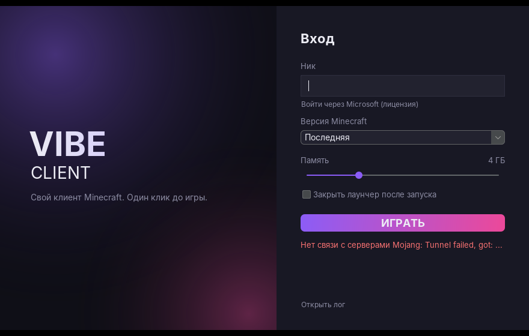

# Vibe Client

Свой клиент Minecraft и лаунчер к нему.



## Лаунчер

Папка `launcher/`. Java 17+, интерфейс на Swing (FlatLaf).

Что делает при нажатии «Играть»:

1. Берёт список версий у Mojang и выбирает последнюю (или выбранную).
2. Ставит Fabric Loader для этой версии (meta.fabricmc.net).
3. Скачивает jar игры, библиотеки, ресурсы, проверяя sha1.
4. Скачивает нужную Java от Mojang, ставить Java вручную не надо.
5. Кладёт в `mods/` Fabric API (с Modrinth) и сам Vibe Client.
6. Запускает игру. Лог видно по кнопке «Открыть лог».

Всё хранится отдельно от обычного Minecraft:

| ОС | Папка |
|---|---|
| Windows | `%APPDATA%\.vibeclient` |
| macOS | `~/Library/Application Support/vibeclient` |
| Linux | `~/.vibeclient` |

### Аккаунты

- **По нику (офлайн)**: одиночная игра и сервера без лицензии.
- **Microsoft (лицензия)**: кнопка «Войти через Microsoft». Нужен свой client id приложения Azure:
  1. Зарегистрируй приложение на portal.azure.com (App registrations), тип аккаунтов «Personal Microsoft accounts only»,
     включи «Allow public client flows».
  2. Подай заявку Mojang на доступ к Minecraft API для этого приложения (форма по ссылке в
     [Minecraft Help](https://help.minecraft.net/hc/en-us/articles/16254801392141)). Без одобрения вход
     дойдёт до последнего шага и получит отказ.
  3. Впиши client id в `settings.json` лаунчера (`"msClientId": "..."`) или передай `-Dvibe.msClientId=...`.

### Сборка

```
./gradlew build
```

Готовый файл: `launcher/build/libs/VibeLauncher.jar`, запуск двойным кликом или `java -jar VibeLauncher.jar`.

Без окна (удобно для отладки):

```
java -jar VibeLauncher.jar --cli --name Steve [--version 1.21.10] [--memory 4096] [--client путь/к/vibe-client.jar]
```

## Клиент

Папка `client/`. Minecraft 26.3, Fabric. Собственный код, без чужих исходников.

Меню на **Right Shift** (ClickGUI): окно с вкладками Combat, Movement, Render, Player, HUD.
Клик по карточке модуля включает его, клик по «+» раскрывает
настройки (ползунки, переключатели, режимы) и клавишу: нажать «Клавиша», затем нужную клавишу.
Список прокручивается колесом или двумя пальцами. Окно и блоки HUD перетаскиваются мышью,
цвет меню и HUD выбирается в модуле «Тема» (есть радуга). Всё сохраняется в `config/vibe-client.json`.

| Категория | Модули |
|---|---|
| Combat | KillAura (авто-поворот, криты прыжком), TriggerBot, AimAssist, BowAimbot, AutoTotem, Velocity, удар зажатием |
| Movement | Sprint, Speed и Fly (пресеты Легит/Средний/Макс), Strafe, NoFall |
| Render | ESP, Tracers, FullBright, Zoom (зажать C) |
| Player | AutoArmor, AutoEat, AutoSoup, FastPlace, авто-возрождение, координаты смерти |
| HUD | ватермарк, FPS, координаты, CPS, клавиши, часы, броня, эффекты, список модулей, карточка цели |

### Где работают чит-модули

Чит-модули (`CheatModule`) работают только в одиночной игре и на серверах из белого списка
в `ServerGuard`, где читы прямо разрешены правилами. На остальных серверах они выключаются
сами и не включаются. Обходов античитов в клиенте нет и не будет: если модуль флагает,
уменьшите его настройку до того, что сервер разрешает.

### Другие версии серверов

Внутри клиента вшит [ViaFabricPlus](https://github.com/ViaVersion/ViaFabricPlus): версию сервера
(1.7–26.x) выбирают кнопкой в списке серверов. ViaFabricPlus распространяется по GPL-3.0,
поэтому при раздаче клиента другим людям исходники Vibe Client тоже нужно открыть.

Собранный клиент вшивается в лаунчер (`client/vibe-client.jar`) и при каждом запуске копируется в `mods`.

Версии игры, Fabric и Fabric API лежат в `gradle.properties`.

## Сборка в GitHub Actions

Каждый push собирает лаунчер и клиент, запускает игру в виртуальном экране для проверки
и выкладывает `VibeLauncher.jar` в артефакты сборки (вкладка Actions).
Push в рабочую ветку обновляет релиз [nightly](../../releases/tag/nightly) с `VibeClient.dmg` для macOS.
Там же лежит `VibeClient-mac.zip` с тем же приложением.

### Первый запуск на Mac

У клиента нет подписи Apple, поэтому macOS при первом запуске его блокирует. Разрешить один раз:

1. Перетащить Vibe Client в «Программы», дважды нажать на него, в окне с ошибкой нажать «Готово».
2. «Системные настройки» → «Конфиденциальность и безопасность» → внизу «Всё равно открыть».

Если macOS пишет, что приложение повреждено, в «Терминале»:

```
xattr -cr "/Applications/Vibe Client.app"
```
